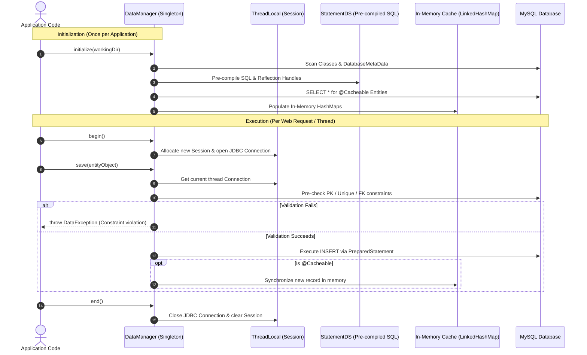

# ORMFM: Object-Relational Mapping Framework

A lightweight, reflection-driven Java Object-Relational Mapping (ORM) framework and automated developer toolkit. **ORMFM** bridges relational databases (MySQL) and Java applications by eliminating repetitive JDBC boilerplate, automating POJO generation, enforcing application-layer schema constraints, isolating database connections across concurrent threads, and generating live schema documentation in PDF format.

---

## Table of Contents

- [Overview](#overview)
- [Key Features](#key-features)
- [Architectural Comparison: Hibernate vs ORMFM](#architectural-comparison-hibernate-vs-ormfm)
- [System Architecture & Lifecycle](#system-architecture--lifecycle)
- [Project Directory Layout](#project-directory-layout)
- [Annotation Reference](#annotation-reference)
  - [Class-Level Annotations](#class-level-annotations)
  - [Field-Level Annotations](#field-level-annotations)
- [The Two Core Components](#the-two-core-components)
  - [1. ORMFMTool (CLI Code Generator & Doc Engine)](#1-ormfmtool-cli-code-generator--doc-engine)
  - [2. DataManager (Runtime Persistence Engine)](#2-datamanager-runtime-persistence-engine)
- [Thread Safety & Multi-Threading Model](#thread-safety--multi-threading-model)
- [CRUD Operations & Validation-First Flow](#crud-operations--validation-first-flow)
- [Query API & View Support](#query-api--view-support)
- [In-Memory Caching System](#in-memory-caching-system)
- [Configuration Reference (`conf.json`)](#configuration-reference-confjson)
- [End-to-End Quickstart Guide](#end-to-end-quickstart-guide)
- [Building the Framework from Source](#building-the-framework-from-source)

---

## Overview

In traditional Java database programming using raw JDBC, developers spend substantial effort writing repetitive code:
1. Manually authoring SQL `INSERT`, `UPDATE`, `DELETE`, and `SELECT` strings.
2. Iterating through `ResultSet` cursors and manually extracting fields with getter methods.
3. Writing error-prone boilerplate to map SQL data types to Java objects.
4. Managing connection leaks and transaction boundaries across multi-threaded web applications.
5. Handling database-level foreign key and constraint exceptions after queries fail.

**ORMFM** resolves these challenges by providing:
- **Automated POJO Generation**: Introspects live database schemas through `DatabaseMetaData` and automatically writes annotated Java entity classes.
- **Dynamic Reflection-Driven Mapping**: Discovers entities, properties, and relationships at runtime using runtime annotations.
- **Pre-Compiled Statement Optimization**: Pre-computes SQL statements and pre-resolves Java reflection `Method` handles during startup to maximize runtime execution speed.
- **Application-Layer Validation**: Validates primary key uniqueness, foreign key integrity, and unique constraints before executing write statements against the database.
- **Thread-Isolated Sessions**: Employs `ThreadLocal<Session>` to provide thread-safe database connections in multi-threaded environments such as Apache Tomcat servlets.
- **In-Memory Caching**: Implements a synchronized heap cache (`LinkedHashMap`) for frequently accessed lookup entities.
- **Automated Documentation**: Uses the iText 9 PDF engine to generate a visual, detailed PDF reference of the database schema and POJO models.

---

## Key Features

- **Zero-Boilerplate POJO Generation (`ORMFMTool`)**: Inspects tables, views, primary keys, auto-increment sequences, and foreign key relations to produce fully annotated Java source files.
- **Integrated Java Compiler**: Compiles generated POJOs dynamically on the fly via `javax.tools.JavaCompiler` and packages them into reusable JAR files.
- **Automated Schema PDF Generator**: Generates formatted PDF specification manuals complete with table descriptions, column types, keys, and visual status indicators.
- **ThreadLocal Session Management**: Isolates JDBC connections per thread, preventing connection crossover and ensuring safe concurrent servlet execution.
- **Validation-First Data Integrity**: Performs proactive verification of primary keys, unique columns, and foreign key relationships before issuing SQL writes.
- **Fluent Query Builder**: Provides a chainable, readable query builder supporting `where()`, `eq()`, `like()`, and `orderBy()` conditions.
- **First-Class View Support**: Natively binds SQL views to read-only POJOs with automatic schema introspection.
- **In-Memory Caching (`@Cacheable`)**: Caches reference tables in memory at initialization and automatically synchronizes the cache upon write operations.

---

## Architectural Comparison: Hibernate vs ORMFM

ORMFM was engineered from the ground up to explore and demonstrate the internal mechanics of production ORM solutions:

| Industry Standard (Hibernate/JPA) | ORMFM Equivalent | Purpose in ORMFM |
|---|---|---|
| `@Entity` / `@Table` | `@Table` | Marks a Java class as a table-backed entity |
| `@Id` | `@PrimaryKey` | Identifies the primary key attribute |
| `@GeneratedValue` | `@AutoIncrement` | Marks database-generated sequence keys |
| `@Column(unique=true)` | `@Unique` | Triggers pre-insert uniqueness validation |
| `@ManyToOne` / `@JoinColumn` | `@ForeignKey` | Validates relational integrity and parent existence |
| Hibernate Tools / Reverse Engineering | `ORMFMTool` | CLI tool generating POJOs, JARs, and PDF docs |
| `SessionFactory` | `DataManager` (Singleton) | Single application-wide metadata and cache holder |
| `Session` | `DataManager.Session` (`ThreadLocal`) | Thread-scoped JDBC connection and query builder |
| First-Level / Second-Level Cache | `@Cacheable` + `queryDS()` | In-memory `LinkedHashMap` keyed by primary key |
| CriteriaBuilder / HQL | `query().where().eq().fire()` | Fluent SQL query constructor |

---

## System Architecture & Lifecycle

ORMFM operates in two distinct phases: **Setup Time** (using `ORMFMTool`) and **Runtime** (using `DataManager`).

```
+-------------------------------------------------------------------------+
|                               SETUP PHASE                               |
|                                                                         |
|  [MySQL Database]                                                       |
|         │                                                               |
|         ▼ (DatabaseMetaData)                                            |
|   ORMFMTool                                                             |
|         ├──────► Generates POJO Source (.java)                          |
|         ├──────► Compiles via javax.tools.JavaCompiler                  |
|         ├──────► Packages Entity JAR (dist/*.jar)                       |
|         └──────► Generates Schema PDF Documentation (dist/*.pdf)        |
+-------------------------------------------------------------------------+
                                     │
                                     ▼
+-------------------------------------------------------------------------+
|                               RUNTIME PHASE                             |
|                                                                         |
|  Tomcat Servlet / Application Thread                                    |
|         │                                                               |
|         ▼                                                               |
|   DataManager.initialize() ──► Scans Annotations & Builds StatementDS   |
|         │                  ──► Pre-loads @Cacheable Tables to Memory    |
|         ▼                                                               |
|   dm.begin()               ──► Binds dedicated JDBC Connection to Thread|
|         │                                                               |
|   dm.save() / query()      ──► Executes SQL using Pre-Compiled Models   |
|         │                                                               |
|   dm.end()                 ──► Closes Connection & Clears Thread State  |
+-------------------------------------------------------------------------+
```

### Execution Sequence Diagram



---

## Project Directory Layout

```
ormfm/
├── WEB-INF/
│   ├── web.xml                      # Servlet container configuration
│   ├── conf.json                    # Database credentials & target package
│   ├── logo.png                     # Optional logo used in generated PDF documents
│   │
│   ├── classes/                     # Framework source code & build scripts
│   │   ├── create_jar.sh            # Script to build ormfm.jar
│   │   └── com/ashvin/orm/fm/
│   │       ├── ORMFMTool.java       # POJO generator, compiler, and PDF engine
│   │       ├── ORMFMStarter.java    # Servlet container startup initializer
│   │       ├── annotations/         # Custom runtime annotations
│   │       ├── exceptions/          # DataException custom exception class
│   │       ├── model/               # DataManager, ORMDataModel, StatementDS
│   │       └── utils/               # ORMUtils, JDBCMethodExtractor, PojoCopier
│   │
│   ├── lib/                         # Framework dependencies
│   │   ├── ormfm.jar                # Packaged ORMFM framework binary
│   │   ├── mysql.jar                # MySQL JDBC Connector
│   │   ├── gson.jar                 # Google Gson for JSON parsing
│   │   ├── kernel-9.1.0.jar         # iText 9 PDF Kernel
│   │   ├── layout-9.1.0.jar         # iText 9 Layout Engine
│   │   ├── io-9.1.0.jar             # iText 9 I/O subsystem
│   │   └── slf4j-api-2.0.17.jar     # Logging facade
│   │
│   ├── src/                         # Generated POJO source files
│   ├── dist/                        # Output generated JARs and PDF documents
│   │
│   ├── docs/                        # Complete 13-part framework documentation
│   └── testing/                     # End-to-end integration test suites & shell scripts
```

---

## Annotation Reference

ORMFM provides 9 runtime annotations residing in `com.ashvin.orm.fm.annotations.*`. All annotations use `@Retention(RetentionPolicy.RUNTIME)` to allow runtime reflection processing.

### Class-Level Annotations

#### 1. `@Table(name = "table_name")`
- **Target**: `ElementType.TYPE`
- **Description**: Identifies a Java POJO as mapping directly to a database table.
- **Example**:
  ```java
  @Table(name = "student")
  public class Student { ... }
  ```

#### 2. `@View(name = "view_name")`
- **Target**: `ElementType.TYPE`
- **Description**: Marks a POJO as a database view representation. Views are strictly read-only; attempts to call `save()`, `update()`, or `delete()` on a view POJO throw a `DataException`.
- **Example**:
  ```java
  @View(name = "v_student_course")
  public class VStudentCourse { ... }
  ```

#### 3. `@Cacheable`
- **Target**: `ElementType.TYPE`
- **Description**: Instructs the framework to cache the entire table in JVM heap memory during `DataManager.initialize()`. Best suited for frequently read, rarely updated lookup tables (e.g., courses, categories, roles).
- **Example**:
  ```java
  @Table(name = "course")
  @Cacheable
  public class Course { ... }
  ```

---

### Field-Level Annotations

#### 4. `@Column(name = "column_name")`
- **Target**: `ElementType.FIELD`
- **Description**: Maps a Java class field to a specific database column name.
- **Example**:
  ```java
  @Column(name = "first_name")
  private String firstName;
  ```

#### 5. `@PrimaryKey`
- **Target**: `ElementType.FIELD`
- **Description**: Designates the primary key column for the table. Required for write operations (`update`, `delete`, and non-auto-increment `save`).
- **Example**:
  ```java
  @PrimaryKey
  @Column(name = "roll_number")
  private int rollNumber;
  ```

#### 6. `@AutoIncrement`
- **Target**: `ElementType.FIELD`
- **Description**: Indicates that the primary key value is generated by the database (e.g., MySQL `AUTO_INCREMENT`). On `save()`, ORMFM retrieves the generated key and sets it back onto the POJO instance.
- **Example**:
  ```java
  @PrimaryKey
  @AutoIncrement
  @Column(name = "code")
  private int code;
  ```

#### 7. `@Unique`
- **Target**: `ElementType.FIELD`
- **Description**: Flags a column that must remain unique. Before saving or updating, the engine executes a query to ensure no duplicate entry exists.
- **Example**:
  ```java
  @Unique
  @Column(name = "aadhar_card_number")
  private String aadharCardNumber;
  ```

#### 8. `@ForeignKey(parent = ParentClass.class, column = "parent_col")`
- **Target**: `ElementType.FIELD`
- **Description**: Declares a foreign key constraint linking to a parent entity. Validates that the referenced record exists in the parent table prior to `save()` or `update()`, and blocks deletion of parents if active child rows exist.
- **Example**:
  ```java
  @ForeignKey(parent = Course.class, column = "code")
  @Column(name = "course_code")
  private int courseCode;
  ```

#### 9. `@SetterGetter`
- **Target**: `ElementType.FIELD`
- **Description**: Explicitly marks that the field has standard JavaBean getter and setter methods that the framework can inspect and invoke via reflection.

---

## The Two Core Components

### 1. ORMFMTool (CLI Code Generator & Doc Engine)

`ORMFMTool` connects to the target database at build time, discovers schema structure, generates source code, compiles artifacts, and produces PDF documentation.

```java
import com.ashvin.orm.fm.ORMFMTool;

public class ToolRunner {
    public static void main(String[] args) throws Exception {
        ORMFMTool tool = new ORMFMTool();
        
        // 1. Initialize from conf.json in the current working directory
        tool.init();
        
        // 2. Generate annotated POJOs for all tables and views into src/
        tool.createPojo();
        tool.createViewPojo();
        
        // 3. Compile POJOs and package them into dist/generated_pojo.jar
        tool.createJar();
        
        // 4. Generate structured PDF schema documentation into dist/
        tool.createPDFDocumentation();
    }
}
```

#### What ORMFMTool Generates:
1. **Java Source Files**: Generates POJOs with clean camelCase variable names, getter/setter pairs, and full annotations (`@Table`, `@Column`, `@PrimaryKey`, `@ForeignKey`, etc.).
2. **Compiled JAR**: Invokes the Java compiler (`javax.tools.JavaCompiler`) and packages compiled `.class` files into `dist/generated_pojo.jar`.
3. **PDF Technical Documentation**: Creates a formatted PDF (`dist/doc.pdf`) using iText 9 detailing:
   - Database summary and table catalog
   - Column names, SQL types, and mapped Java types
   - Primary key, auto-increment, unique, and foreign key badges
   - View definitions and underlying mappings

---

### 2. DataManager (Runtime Persistence Engine)

`DataManager` is the runtime interface used by application services and servlets. It is implemented as a thread-safe singleton.

#### Internal Initialization Flow
```java
// Run once during web application startup (e.g., ServletContextListener)
DataManager.initialize(new File("/path/to/project/root"));

// Retrieve the singleton instance anywhere in the codebase
DataManager dm = DataManager.getDataManager();
```

During `initialize()`:
1. `conf.json` is read to establish database connectivity.
2. All entity classes in the configured package are scanned via Java Reflection.
3. For every entity, an `ORMDataModel` is generated, and a collection of `StatementDS` objects is pre-compiled (for `insert`, `update`, `delete`, `select`, `pk_check`, and `fk_check`).
4. Reflection `Method` handles for getters, setters, and JDBC `PreparedStatement` setters are cached.
5. All `@Cacheable` tables are read via `SELECT *` and stored in memory.

---

## Thread Safety & Multi-Threading Model

In multi-threaded web application servers like Apache Tomcat, multiple HTTP request threads access persistence services simultaneously. ORMFM guarantees thread isolation through `ThreadLocal<Session>`:

```java
private static final ThreadLocal<Session> threadSession = 
    ThreadLocal.withInitial(() -> new Session());
```

### Thread Safety Architecture

| Component | State Type | Thread Safety Mechanism |
|---|---|---|
| `DataManager` singleton | Shared class instance | Read-only after startup; no write contention |
| `statements` map | Pre-compiled metadata | Immutable cache created during `initialize()` |
| JDBC `Connection` | Per-thread resource | Stored inside `ThreadLocal<Session>` |
| Query builder state (`qStatement`) | Per-thread resource | Bound strictly to calling thread's `Session` |
| In-Memory Cache (`@Cacheable`) | Shared heap memory | Synchronized updates during write operations |

### Safe Thread Execution Pattern

```java
DataManager dm = DataManager.getDataManager();
try {
    dm.begin(); // Acquires a distinct JDBC Connection for this thread
    
    // Execute database operations
    List<Course> list = (List<Course>) dm.query(Course.class).fire();
    
} finally {
    dm.end();   // Closes the thread's JDBC Connection and resets Session state
}
```

---

## CRUD Operations & Validation-First Flow

All write operations in ORMFM implement a strict **validation-first** pattern:

```
save() / update() / delete()
      │
      ├─► Phase 1: Primary Key Validation (verifies presence and uniqueness)
      ├─► Phase 2: Unique Column Validation (checks duplicate collisions)
      ├─► Phase 3: Foreign Key Integrity Check (ensures parent row exists)
      ├─► Phase 4: Execute SQL PreparedStatement
      ├─► Phase 5: Retrieve and assign auto-generated keys (if @AutoIncrement)
      └─► Phase 6: Update In-Memory Cache (if entity has @Cacheable)
```

### 1. Insert Record (`save`)

```java
dm.begin();

Course course = new Course();
course.setTitle("Distributed Systems Architecture");
dm.save(course);

// Auto-increment primary key is automatically injected back into the POJO
System.out.println("Generated Course Code: " + course.getCode());

dm.end();
```

### 2. Update Record (`update`)

```java
dm.begin();

Course course = new Course();
course.setCode(1);
course.setTitle("Advanced Java Programming");
dm.update(course);

dm.end();
```

### 3. Delete Record (`delete`)

```java
dm.begin();

// Deletes the course with primary key = 1
// Validates whether child records in student reference course_code = 1
// If child records exist, throws DataException and cancels deletion
dm.delete(Course.class, 1);

dm.end();
```

---

## Query API & View Support

ORMFM provides both a fluent, chainable query builder for tables and direct retrieval for database views.

### 1. Fluent Query Builder (Tables)

```java
dm.begin();

// SELECT * FROM student WHERE first_name = 'Rohit' ORDER BY last_name
List<Student> students = (List<Student>) dm
    .query(Student.class)
    .where("first_name").eq("Rohit")
    .orderBy("last_name")
    .fire();

// Specific column projections:
// SELECT first_name, last_name FROM student WHERE gender = 'M'
List<Student> selectedCols = (List<Student>) dm
    .select(Student.class, new String[]{"first_name", "last_name"})
    .where("gender").eq("M")
    .fire();

dm.end();
```

### 2. Supported Query Operators

- `.where("column_name")`: Introduces the filter clause (or appends `AND` if a condition already exists).
- `.eq(value)`: Equivalence comparison (`column = 'value'`).
- `.like(value)`: Pattern matching (`column LIKE 'value'`).
- `.orderBy("column_name")`: Sorts the result set.
- `.fire()`: Executes the compiled query and converts the `ResultSet` into a typed `List<T>`.

### 3. View Queries (Read-Only)

Database views are retrieved without needing to manually write SQL `JOIN` syntax:

```java
dm.begin();

// SELECT * FROM v_student_course
List<VStudentCourse> viewList = (List<VStudentCourse>) dm.view(VStudentCourse.class);

for (VStudentCourse item : viewList) {
    System.out.println(item.getFirstName() + " enrolled in " + item.getTitle());
}

dm.end();
```

---

## In-Memory Caching System

For tables marked with `@Cacheable`, ORMFM eliminates database round-trips for repetitive reads by keeping records in an in-memory `LinkedHashMap`.

```
Application Read
       │
       ▼
  queryDS(Course.class)
       │
       ├─► Returns collection directly from RAM (LinkedHashMap)
       └─► 0 ms database latency; 0 SQL queries executed
```

### Cache Usage Example

```java
// Instant read from heap memory without opening a database transaction
List<Course> cachedCourses = (List<Course>) dm.queryDS(Course.class);
```

### Cache Synchronization Rules
- **On `save()`**: Newly inserted objects are placed into the in-memory cache map keyed by their primary key.
- **On `update()`**: The corresponding primary key entry in the cache map is updated with the modified POJO.
- **On `delete()`**: The primary key entry is evicted from the cache map immediately after the SQL delete completes.

---

## Configuration Reference (`conf.json`)

The framework relies on a single JSON configuration file placed in the working directory:

```json
{
  "jdbc-driver": "com.mysql.cj.jdbc.Driver",
  "connection-url": "jdbc:mysql://localhost:3306/school_db",
  "username": "schooluser1",
  "password": "school#User1",
  "package-name": "testing.school.pojo"
}
```

### Configuration Parameters

| Property | Type | Description |
|---|---|---|
| `jdbc-driver` | `String` | Fully qualified name of the JDBC Driver class |
| `connection-url` | `String` | JDBC database connection string |
| `username` | `String` | Database user account |
| `password` | `String` | Database user password |
| `package-name` | `String` | Package namespace for generated and scanned POJO classes |

---

## End-to-End Quickstart Guide

### Step 1: Create Database and Tables

```sql
CREATE DATABASE school_db;
USE school_db;

CREATE TABLE course (
    code INT PRIMARY KEY AUTO_INCREMENT,
    title CHAR(35) NOT NULL
);

CREATE TABLE student (
    roll_number INT PRIMARY KEY,
    first_name CHAR(20) NOT NULL,
    last_name CHAR(20) NOT NULL,
    aadhar_card_number CHAR(20) NOT NULL UNIQUE,
    course_code INT NOT NULL,
    gender CHAR(1) NOT NULL,
    date_of_birth DATE NOT NULL,
    FOREIGN KEY (course_code) REFERENCES course(code)
);

CREATE VIEW v_student_course AS
SELECT s.roll_number, s.first_name, s.last_name, c.title AS course_title
FROM student s
JOIN course c ON s.course_code = c.code;
```

### Step 2: Configure `conf.json`

Create `conf.json` with your database credentials in your working folder as shown in the [Configuration Reference](#configuration-reference-confjson).

### Step 3: Run ORMFMTool to Generate Code and Docs

```java
import com.ashvin.orm.fm.ORMFMTool;

public class GenerateArtifacts {
    public static void main(String[] args) throws Exception {
        ORMFMTool tool = new ORMFMTool();
        tool.init();
        tool.createPojo();
        tool.createViewPojo();
        tool.createJar();
        tool.createPDFDocumentation();
        System.out.println("POJOs, JAR, and PDF generated successfully!");
    }
}
```

### Step 4: Perform CRUD Operations

```java
import java.io.File;
import java.util.List;
import com.ashvin.orm.fm.model.DataManager;
import testing.school.pojo.Course;

public class App {
    public static void main(String[] args) throws Exception {
        // Initialize DataManager with current working directory
        DataManager.initialize(new File(System.getProperty("user.dir")));
        DataManager dm = DataManager.getDataManager();

        // 1. Insert a new Course
        dm.begin();
        Course javaCourse = new Course();
        javaCourse.setTitle("Core Java Programming");
        dm.save(javaCourse);
        dm.end();
        System.out.println("Inserted Course with ID: " + javaCourse.getCode());

        // 2. Query Courses
        dm.begin();
        List<Course> courses = (List<Course>) dm.query(Course.class)
            .where("title").like("%Java%")
            .fire();
        dm.end();

        for (Course c : courses) {
            System.out.println("Found: " + c.getCode() + " : " + c.getTitle());
        }
    }
}
```

---

## Building the Framework from Source

To compile the ORMFM framework classes and produce `ormfm.jar`:

```bash
# 1. Navigate to the classes folder
cd /media/ashu/code/tomcat9/webapps/ormfm/WEB-INF/classes

# 2. Compile all framework source files
javac -classpath \
  .:../../lib/*:../../../../../../lib/* \
  com/ashvin/orm/fm/exceptions/*.java \
  com/ashvin/orm/fm/annotations/*.java \
  com/ashvin/orm/fm/utils/*.java \
  com/ashvin/orm/fm/model/*.java \
  com/ashvin/orm/fm/ORMFMTool.java \
  com/ashvin/orm/fm/ORMFMStarter.java

# 3. Package into ormfm.jar
jar -cvf ../lib/ormfm.jar com
jar -cvf ../testing/lib/ormfm.jar com
```

---

## Technical Specifications

- **Target JDK**: Java SE 8 and above (JDK required for on-the-fly compilation).
- **Tested Database**: MySQL 8.0+ / MariaDB 10.4+.
- **Servlet Container Compatibility**: Apache Tomcat 9.x / 10.x.
- **Key Dependencies**:
  - `iText 9.1.0` (PDF generation engine)
  - `Gson 2.x` (Configuration JSON parser)
  - `SLF4J 2.0.x` (Logging facade)
  - `MySQL Connector/J` (JDBC driver)
- **Design Patterns Applied**: Singleton, Front Controller, ThreadLocal Session, Strategy, Data Access Object (DAO), Factory Method.
