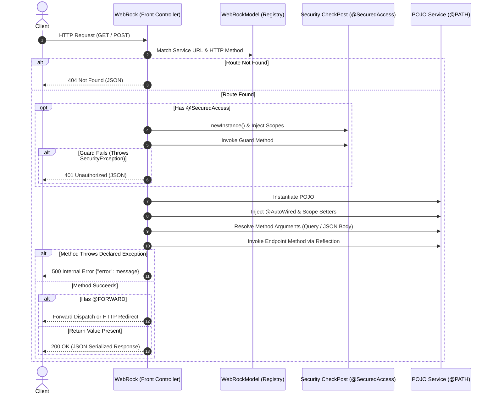

# WebRock Framework

A lightweight, annotation-driven Java MVC web framework built on top of standard Java Servlet APIs (Servlet 4.0). **WebRock** eliminates J2EE servlet boilerplate by introducing reflection-driven routing, inversion-of-control (IoC) dependency injection, automated ES6 JavaScript client compilation, declarative security interceptors, and dynamic live PDF documentation generation.

---

## Table of Contents

- [Overview](#overview)
- [Key Features](#key-features)
- [Architecture & Request Lifecycle](#architecture--request-lifecycle)
- [Project Directory Layout](#project-directory-layout)
- [Comprehensive Annotation Reference](#comprehensive-annotation-reference)
- [Context Scopes & Dependency Injection](#context-scopes--dependency-injection)
- [Auto-Generated JavaScript Client](#auto-generated-javascript-client)
- [Self-Documenting API (PDF Generator)](#self-documenting-api-pdf-generator)
- [Quickstart Guide](#quickstart-guide)
  - [1. Configure `web.xml`](#1-configure-webxml)
  - [2. Define a Model / DTO](#2-define-a-model--dto)
  - [3. Build a Controller Service](#3-build-a-controller-service)
  - [4. Enforce Security Access](#4-enforce-security-access)
  - [5. Consume in Frontend](#5-consume-in-frontend)
- [Build & Deployment](#build--deployment)
- [Documentation Index](#documentation-index)

---

## Overview

In traditional Java Enterprise (J2EE) development, building RESTful or web services requires substantial boilerplate:
1. Extending `HttpServlet` for every endpoint or module.
2. Manually mapping every servlet and URL pattern in `web.xml`.
3. Repetitive extraction of query strings, type casting, and manual JSON marshalling/unmarshalling.
4. Manually syncing client-side AJAX/fetch scripts with backend URL paths and payloads.

**WebRock** addresses these issues by implementing a Spring Boot-inspired programming model directly on standard Servlet containers (e.g., Apache Tomcat):
- Plain Old Java Objects (**POJOs**) act as controllers and services.
- A centralized **Front Controller** catches requests and delegates via Java Reflection.
- Startup classpath scanning auto-registers endpoints, compiles client scripts, and produces documentation.

---

## Key Features

- **Front Controller Architecture (`WebRock.java`)**: A unified dispatcher intercepting incoming routes and dispatching them dynamically to POJO methods via an in-memory route table ($O(1)$ lookup).
- **Classpath Scanning & Bootstrap (`WebRockStarter.java`)**: On container startup (`<load-on-startup>0</load-on-startup>`), scans configured packages, builds endpoint metadata (`WebRockModel`), and executes `@OnStartup` tasks in prioritized sequence.
- **Inversion of Control & Auto-Wiring (`@AutoWired`)**: Field-level injection resolving attributes across Request, Session, and Application scopes with automatic primitive type conversion and wrapper safety.
- **Decoupled Context Scopes**: Clean wrapper classes (`RequestScope`, `SessionScope`, `ApplicationScope`, `ApplicationDirectory`) that decouple your business logic from raw `HttpServletRequest` and `HttpSession` APIs.
- **Automated JavaScript Client Compilation**: Emits typed ES6 classes for POJOs and Promise-based API wrappers (`XMLHttpRequest`/`fetch`) for all registered endpoints into `/WEB-INF/js/`, accessible dynamically via `/jsFile`.
- **Dynamic PDF API Documentation**: Employs the **iText** PDF library to compile a complete, beautifully structured API specification catalog (`webrockDOC.pdf`) during server startup.
- **Declarative Security Guards (`@SecuredAccess`)**: Intercepts requests before method execution, running designated checkpost guard methods with scope injection.
- **Data Binding & JSON Deserialization**: Binds query parameters or request body JSON payloads directly to method arguments using Google Gson.

---

## Architecture & Request Lifecycle



### The Two Core Lifecycles

1. **Startup Lifecycle (`WebRockStarter`)**:
   - Reads `SERVICE_PACKAGE_PREFIX` and `SITE_NAME` from `web.xml`.
   - Recursively traverses `WEB-INF/classes` using Java NIO `Files.walk` to find compiled `.class` files.
   - Inspects classes using reflection for `@PATH`, `@POJO`, `@SecuredAccess`, etc.
   - Caches endpoint metadata in the singleton `WebRockModel`.
   - Compiles ES6 JavaScript DTOs and client services into `/WEB-INF/js/`.
   - Generates the API handbook PDF (`[SITE_NAME]DOC.pdf`).
   - Executes `@OnStartup` methods sorted by ascending priority (`priority >= 0`).

2. **Request Lifecycle (`WebRock`)**:
   - Cleanses the site prefix from `requestURI`.
   - Queries `WebRockModel` for the matching route and HTTP verb.
   - Executes security guards if declared.
   - Auto-wires fields and scopes.
   - Deserializes parameters (URL query string or JSON request body).
   - Invokes target method and serializes the return value to JSON.

---

## Project Directory Layout

```
webrock/
├── docs/                                  # Framework documentation & guides
│   ├── webrock_framework_documentation.md # Detailed technical specification
│   ├── webrock_usecase_documentation.md   # End-to-end Student App walkthrough
│   └── framework_review.md                # Architecture and technical overview
├── WEB-INF/
│   ├── web.xml                            # Servlet mappings & framework configuration
│   ├── js/                                # Target directory for auto-compiled JS files
│   ├── lib/                               # Dependencies (iText PDF, Google Gson)
│   └── classes/
│       ├── com/ashvin/web/rock/           # Core Framework Source
│       │   ├── annotations/               # Framework annotations (@PATH, @POJO, etc.)
│       │   ├── exceptions/                # SecurityException, ServiceException
│       │   ├── model/                     # WebRockModel, WebRockPDFCreation
│       │   ├── pojo/                      # Scope wrappers (RequestScope, SessionScope, etc.)
│       │   ├── utils/                     # WebRockUtils (Type parsing & Gson serialization)
│       │   ├── WebRock.java               # Front Controller Servlet
│       │   ├── WebRockStarter.java        # Startup Initializer & Classpath Scanner
│       │   └── JSFileLoading.java         # Servlet serving generated JavaScript
│       │
│       └── bobby/                         # Sample Application & Tests
│           ├── student/                   # StudentDAO, StudentDTO, DB Connection
│           └── test/                      # Test cases (AutoWired, RequestParameter, Security)
├── index.html                             # Main application landing page
├── Student.html                           # Student management dashboard
└── webrockDOC.pdf                         # Auto-generated API documentation PDF
```

---

## Comprehensive Annotation Reference

| Annotation | Target | Description | Example |
| :--- | :--- | :--- | :--- |
| `@PATH(value)` | `TYPE`, `METHOD` | Maps URI routing segments. Class path serves as prefix; method path specifies endpoint. | `@PATH("/studentService")` |
| `@POJO(value)` | `TYPE` | Identifies a domain model / DTO. Automatically compiles an ES6 JS class representation with getters and setters. | `@POJO` |
| `@GET` | `TYPE`, `METHOD` | Restricts endpoint to HTTP `GET` requests. (Defaults to both GET & POST if neither is specified). | `@GET` |
| `@POST` | `TYPE`, `METHOD` | Restricts endpoint to HTTP `POST` requests. (Defaults to both GET & POST if neither is specified). | `@POST` |
| `@AutoWired(name)` | `FIELD` | Automatically injects an attribute by identifier from Request, Session, or Application scope. | `@AutoWired(name = "dbConnection")` |
| `@InjectRequestParameter(value)` | `FIELD` | Injects an HTTP query or form parameter directly into a class field with automatic type conversion. | `@InjectRequestParameter("page")` |
| `@RequestParameter(name)` | `PARAMETER` | Binds a method parameter to a query parameter. If `name` is empty/omitted, binds the raw JSON request body payload. | `@RequestParameter("id") int id` |
| `@SecuredAccess(checkPost, guard)` | `TYPE`, `METHOD` | Intercepts requests and invokes a verification guard method before service execution. | `@SecuredAccess(checkPost = "...", guard = "login")` |
| `@FORWARD(value)` | `METHOD` | On completion, forwards internally to another registered WebRock service or redirects externally. | `@FORWARD("/index.html")` |
| `@OnStartup(priority)` | `METHOD` | Executes the method at container initialization. Sorted by ascending priority ($0, 1, 2, \dots$). | `@OnStartup(priority = 1)` |
| `@InjectRequestScope` | `TYPE` | Injects the `RequestScope` wrapper via `setRequestScope(RequestScope)`. | `@InjectRequestScope` |
| `@InjectSessionScope` | `TYPE` | Injects the `SessionScope` wrapper via `setSessionScope(SessionScope)`. | `@InjectSessionScope` |
| `@InjectApplicationScope` | `TYPE` | Injects the `ApplicationScope` wrapper via `setApplicationScope(ApplicationScope)`. | `@InjectApplicationScope` |
| `@InjectApplicationDirectory` | `TYPE` | Injects the `ApplicationDirectory` wrapper via `setApplicationDirectory(ApplicationDirectory)`. | `@InjectApplicationDirectory` |

---

## Context Scopes & Dependency Injection

To keep service classes pure and unit-testable, WebRock provides scope wrapper POJOs located in `com.ashvin.web.rock.pojo`:

- **`RequestScope`**: Accesses request-level attributes (`setAttribute`, `getAttribute`).
- **`SessionScope`**: Accesses user session state across requests (`setAttribute`, `getAttribute`, `removeAttribute`).
- **`ApplicationScope`**: Accesses global application context data shared across all users.
- **`ApplicationDirectory`**: Supplies the physical webapp deployment directory as a `java.io.File`.

### Auto-Wiring Resolution Hierarchy (`@AutoWired`)

When `@AutoWired(name = "key")` is evaluated on a field:
1. WebRock searches **Request** attributes via `request.getAttribute("key")`.
2. If not found, searches **Session** attributes via `session.getAttribute("key")`.
3. If not found, searches **Application** attributes via `servletContext.getAttribute("key")`.
4. Type safety is enforced against the field's wrapper type (`parameterType.isInstance(...)`).
5. Injected cleanly using reflection; if missing, defaults to `0`, `false`, or `null`.

---

## Auto-Generated JavaScript Client

During application startup, WebRock compiles your Java classes into browser-ready ES6 JavaScript code:

### 1. DTO Classes (`@POJO`)
Generates matching JavaScript classes containing constructor arguments, getters, and setters.
```java
@POJO
public class StudentDTO implements Serializable {
    private int rollNumber;
    private String name;
    // getters and setters...
}
```
**Compiled Output (`StudentDTO.js`)**:
```javascript
class StudentDTO {
    constructor(rollNumber, name) {
        this.rollNumber = rollNumber;
        this.name = name;
    }
    setRollNumber(rollNumber) { this.rollNumber = rollNumber; }
    getRollNumber() { return this.rollNumber; }
    setName(name) { this.name = name; }
    getName() { return this.name; }
}
```

### 2. Service API Clients (`@PATH`)
Generates Promise-based methods handling HTTP requests, query-string serialization, and JSON body delivery:
```javascript
const service = new StudentDAO();

// Automatically dispatches POST with JSON payload
service.add(new StudentDTO(101, "Alice"))
    .then(response => console.log("Added successfully:", response))
    .catch(err => console.error("Error (" + err.status + "):", err.message));
```

Frontend pages can include these files dynamically using the built-in loader:
```html
<script src="/webrock/jsFile?name=StudentDTO.js"></script>
<script src="/webrock/jsFile?name=StudentDAO.js"></script>
```

---

## Self-Documenting API (PDF Generator)

WebRock includes a built-in documentation engine powered by **iText**. Every time the application boots up:
- Scans all discovered services and paths.
- Resolves HTTP methods, input parameters, parameter sources (`Query String`, `JSON payload`, or `Autofilled Scope`), return types, and declared exceptions.
- Inspects security interceptors (`@SecuredAccess`) and wiring configurations.
- Compiles the metadata into a formatted PDF catalog (`[SITE_NAME]DOC.pdf`, e.g., `webrockDOC.pdf`) saved directly in the webapp root directory.

---

## Quickstart Guide

### 1. Configure `web.xml`

Register the package prefix and WebRock servlets:

```xml
<web-app xmlns="http://xmlns.jcp.org/xml/ns/javaee" version="4.0">
    <context-param>
        <param-name>SERVICE_PACKAGE_PREFIX</param-name>
        <param-value>bobby</param-value>
    </context-param>
    <context-param>
        <param-name>SITE_NAME</param-name>
        <param-value>webrock</param-value>
    </context-param>

    <!-- Startup Initializer -->
    <servlet>
        <servlet-name>WebRockStarter</servlet-name>
        <servlet-class>com.ashvin.web.rock.WebRockStarter</servlet-class>
        <load-on-startup>0</load-on-startup>
    </servlet>

    <!-- Core Front Controller -->
    <servlet>
        <servlet-name>StudentManager</servlet-name>
        <servlet-class>com.ashvin.web.rock.WebRock</servlet-class>
    </servlet>
    <servlet-mapping>
        <servlet-name>StudentManager</servlet-name>
        <url-pattern>/studentService/*</url-pattern>
    </servlet-mapping>

    <!-- Generated JS Loader -->
    <servlet>
        <servlet-name>JSFileLoading</servlet-name>
        <servlet-class>com.ashvin.web.rock.JSFileLoading</servlet-class>
    </servlet>
    <servlet-mapping>
        <servlet-name>JSFileLoading</servlet-name>
        <url-pattern>/jsFile</url-pattern>
    </servlet-mapping>
</web-app>
```

### 2. Define a Model / DTO

```java
package bobby.student;

import com.ashvin.web.rock.annotations.POJO;
import java.io.Serializable;

@POJO
public class StudentDTO implements Serializable {
    private int rollNumber;
    private String name;
    private String gender;

    public StudentDTO() {}
    public StudentDTO(int rollNumber, String name, String gender) {
        this.rollNumber = rollNumber;
        this.name = name;
        this.gender = gender;
    }

    public int getRollNumber() { return rollNumber; }
    public void setRollNumber(int rollNumber) { this.rollNumber = rollNumber; }
    public String getName() { return name; }
    public void setName(String name) { this.name = name; }
    public String getGender() { return gender; }
    public void setGender(String gender) { this.gender = gender; }
}
```

### 3. Build a Controller Service

```java
package bobby.student;

import com.ashvin.web.rock.annotations.*;
import java.util.List;

@PATH("/studentService")
public class StudentDAO {

    @POST
    @PATH("/add")
    @SecuredAccess(checkPost = "bobby.test.Authenticate", guard = "checkLogin")
    public void add(StudentDTO student) throws DAOException {
        // Business logic to persist student into database
    }

    @GET
    @PATH("/getByRollNumber")
    public StudentDTO getByRollNumber(@RequestParameter("rollNumber") int rollNumber) throws DAOException {
        // Business logic to query student
        return new StudentDTO(rollNumber, "Bobby", "M");
    }
}
```

### 4. Enforce Security Access

Define a security checkpost class. Guard methods accept context scopes (`RequestScope`, `SessionScope`, etc.) and must return `void`:

```java
package bobby.test;

import com.ashvin.web.rock.pojo.SessionScope;
import com.ashvin.web.rock.exceptions.SecurityException;

public class Authenticate {

    public void checkLogin(SessionScope sessionScope) {
        Object user = sessionScope.getAttribute("user");
        if (user == null) {
            throw new SecurityException("User is not authenticated");
        }
    }
}
```

### 5. Consume in Frontend

```html
<!DOCTYPE html>
<html>
<head>
    <title>WebRock Student Portal</title>
    <!-- Load auto-generated models & clients -->
    <script src="jsFile?name=StudentDTO.js"></script>
    <script src="jsFile?name=StudentDAO.js"></script>
</head>
<body>
    <script>
        const studentService = new StudentDAO();

        // Call GET endpoint with query parameters
        studentService.getByRollNumber(101)
            .then(student => console.log("Student retrieved:", student.getName()))
            .catch(err => console.error("Failed:", err.message));
    </script>
</body>
</html>
```

---

## Build & Deployment

### Dependencies
Required libraries must be placed in `WEB-INF/lib/`:
- **Servlet API 4.0** (`javax.servlet-api`)
- **Google Gson** (`gson-2.8.x.jar`)
- **iText PDF** (`itextpdf-5.x.jar`)

### Compiling
Compile the framework and user packages:

```bash
# Compile Framework
cd WEB-INF/classes/com/ashvin/web/rock
sh compile.sh

# Compile Application / Testing Services
cd ../../../bobby/student
sh compile.sh
```

### Deploying
1. Place the `webrock` project folder inside Tomcat's `webapps/` directory (`$CATALINA_HOME/webapps/webrock`).
2. Start Tomcat (`catalina.sh run` or `startup.sh`).
3. WebRock will initialize, log scanned services, generate JavaScript files in `WEB-INF/js/`, and output `webrockDOC.pdf` to the root folder.

---

## Documentation Index

For in-depth explanations and advanced topics, see the documentation in `docs/`:

- [Framework Technical Documentation](docs/webrock_framework_documentation.md) — Comprehensive reference on routing internals, injection hierarchies, exception handling, and reflection mechanics.
- [Student Management Usecase Walkthrough](docs/webrock_usecase_documentation.md) — Step-by-step tutorial building a complete CRUD application with database persistence.
- [Architecture & Technical Review](docs/framework_review.md) — High-level review of core components, lifecycles, and architectural decisions.
- [Engineering Case Studies & Blogs](docs/portfolio/) — In-depth architectural write-ups on building custom dependency injection, reflection-based code generators, and security interceptors.
